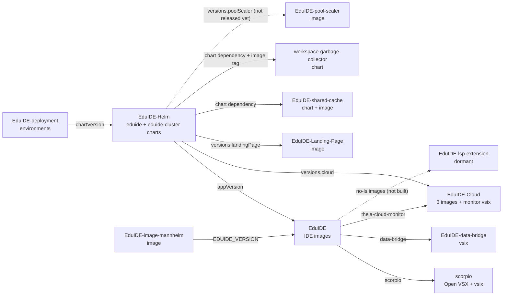

# Releases and Dependencies

Every released EduIDE repository is released by hand. Nothing publishes on a push to `main`. This page shows which repository pins which other repository, in which order to release, and how one release runs.

## Dependency graph

An arrow points from the consumer to the repository whose release it pins. Dashed arrows are pins that are dormant or not released yet.

All repositories also use the org `.github` repository through moving refs (`@v1`, `@main`). These edges are omitted.

## What each repository publishes and pins

| Repository | Publishes | Tag format | Pins from other EduIDE repositories (where) |
|---|---|---|---|
| EduIDE-data-bridge | vsix release asset | `vX.Y.Z` | none |
| scorpio | Open VSX extension, vsix release asset | `vX.Y.Z` | none |
| EduIDE-Cloud | `operator`, `service`, `conversion-webhook` images, monitor vsix | `vX.Y.Z` | none |
| EduIDE-Landing-Page | image | `vX.Y.Z` | none |
| workspace-garbage-collector | Helm chart (OCI) | `theia-workspace-garbage-collector-X.Y.Z` | none |
| EduIDE-shared-cache | Helm chart (OCI), `gradle-cache` image | `eduide-shared-cache-X.Y.Z` | none |
| EduIDE-pool-scaler | image | `vX.Y.Z` | none |
| EduIDE | IDE images (`base` plus the language images) | `vX.Y.Z` | scorpio, data-bridge and the Cloud monitor vsix (`images/base-ide/package.json.patch`, `theiaPlugins`) |
| EduIDE-image-mannheim | image | `vX.Y.Z` | EduIDE (`Dockerfile`, `ARG EDUIDE_VERSION`) |
| EduIDE-Helm | charts `eduide` and `eduide-cluster` (OCI) | `vX.Y.Z` (chart version) | EduIDE (`Chart.yaml` `appVersion`), EduIDE-Cloud (`values.yaml` `versions.cloud`), Landing-Page (`versions.landingPage`), shared-cache and garbage-collector (`Chart.yaml` `dependencies`, plus the garbage-collector image tag in `values.yaml`) |
| eduide-keycloak-theme | JAR and checksum release assets | `vX.Y.Z` | none |
| EduIDE-deployment | not released | none | EduIDE-Helm (`environments/*/env.yaml`, `spec.platform.chartVersion`) |

## Release order

A repository releases after everything it pins.

1. Leaves: scorpio, data-bridge, EduIDE-Cloud, Landing-Page, shared-cache, garbage-collector, pool-scaler.
2. EduIDE, because it pins the extensions and the Cloud monitor.
3. EduIDE-Helm and EduIDE-image-mannheim, because they pin the EduIDE images and the leaves.
4. Deployment pull requests that move `chartVersion` in EduIDE-deployment.

Skip every step that has no unreleased changes.

## How a release runs

Each released repository has a release skill at `.claude/skills/release/SKILL.md`. Run it from Claude Code in that repository.

1. The skill finds the last release and the changes since then.
2. It proposes a version (semver from the changes, `-rc.N` for prereleases) and asks you to confirm or change it.
3. It checks every pin on other EduIDE repositories. A pin must point at the latest release of its repository. If that repository has unreleased changes on `main`, the skill asks whether to release it first and then follows that repository's release skill.
4. It writes the release notes into `CHANGELOG.md` and opens a release pull request with the version bump and the changelog.
5. After the pull request is merged, `release.yml` is dispatched with the version.

`release.yml` calls the reusable release workflow of the org `.github` repository. That workflow validates the version, takes the notes from the `CHANGELOG.md` section, creates the tag and the GitHub Release. The repository's own jobs then publish the artifacts (images, charts, vsix files) and verify them.

Release candidates (`-rc.N`) publish GitHub release assets and images only, never to Open VSX.

A tag or Release created with `GITHUB_TOKEN` does not trigger other workflows. This is why the publish jobs run from `release.yml` and not from `on: release`.
