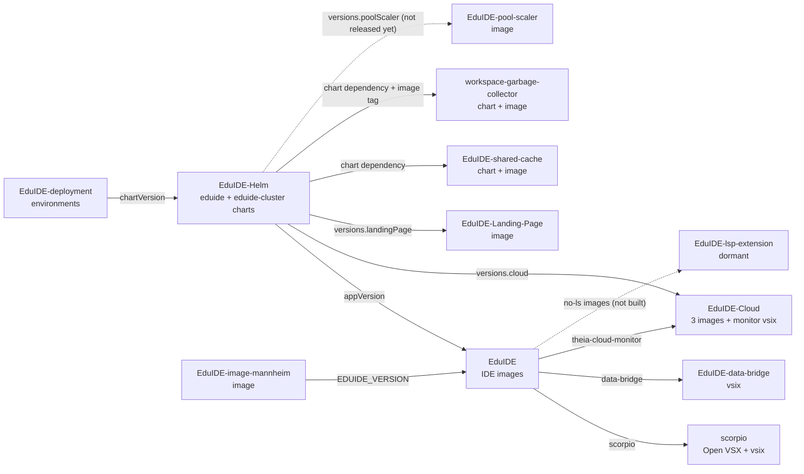

# Releases and Dependencies

Every released EduIDE repository is released by hand. Nothing publishes on a push to `main`. This page shows which repository pins which other repository, in which order to release, and how one release runs.

## Dependency graph

An arrow points from the consumer to the repository whose release it pins. Dashed arrows are pins that are dormant or not released yet.

All repositories also use the org `.github` repository through moving refs (`@v1`, `@main`). These edges are omitted.

## Versions of the 3.0 release

| Repository | Version |
|---|---|
| EduIDE-Helm (`eduide`, `eduide-cluster`) | 3.0.0 |
| EduIDE (IDE images) | 2.0.0 |
| EduIDE-Cloud | 3.0.0, 3.0.1 for the admin API toggle, no environment values in operator logs and the data bridge in lazy sessions |
| EduIDE-data-bridge | 2.0.0 |
| scorpio | 3.0.0, 3.1.0 for the progress notification |
| workspace-garbage-collector | 1.0.0 |
| EduIDE-Landing-Page | 1.4.1 |

The security fixes of the audit made several of these major releases: EduIDE-Cloud 3.0.0, data bridge 2.0.0, scorpio 3.0.0 and the first stable garbage collector 1.0.0. Use strict semver: a breaking change is a major release.

## What each repository publishes and pins

| Repository | Publishes | Tag format | Pins from other EduIDE repositories (where) |
|---|---|---|---|
| EduIDE-data-bridge | vsix release asset | `vX.Y.Z` | none |
| scorpio | Open VSX extension, vsix release asset | `vX.Y.Z` | none |
| EduIDE-Cloud | `operator`, `service`, `conversion-webhook` images, monitor vsix | `vX.Y.Z` | none |
| EduIDE-Landing-Page | image | `vX.Y.Z` | none |
| workspace-garbage-collector | Helm chart (OCI), `garbage-collector` image | `vX.Y.Z` (until 0.2.0: `theia-workspace-garbage-collector-X.Y.Z`) | none |
| EduIDE-shared-cache | Helm chart (OCI), `gradle-cache` image | `vX.Y.Z` (until 0.5.3: `eduide-shared-cache-X.Y.Z`) | none |
| EduIDE-pool-scaler | image | `vX.Y.Z` | none |
| EduIDE | IDE images (`base` plus the language images) | `vX.Y.Z` | scorpio, data-bridge and the Cloud monitor vsix (`images/base-ide/package.json.patch`, `theiaPlugins`) |
| EduIDE-image-mannheim | image | `vX.Y.Z` | EduIDE (`Dockerfile`, `ARG EDUIDE_VERSION`) |
| EduIDE-Helm | charts `eduide` and `eduide-cluster` (OCI) | `vX.Y.Z` (chart version) | EduIDE (`Chart.yaml` `appVersion`), EduIDE-Cloud (`values.yaml` `versions.cloud`), Landing-Page (`versions.landingPage`), shared-cache and garbage-collector (`Chart.yaml` `dependencies`, plus the garbage-collector image tag in `values.yaml`) |
| eduide-keycloak-theme | JAR and checksum release assets | `vX.Y.Z` | none |
| EduIDE-deployment | not released | none | EduIDE-Helm (`environments/*/env.yaml`, `spec.platform.chartVersion`) |

## Release order

A repository releases after everything it pins.

1. Leaves: scorpio, data-bridge, EduIDE-Cloud, Landing-Page, shared-cache, garbage-collector, pool-scaler.
2. EduIDE, because it pins the extensions and the Cloud monitor.
3. EduIDE-Helm and EduIDE-image-mannheim, because they pin the EduIDE images and the leaves.
4. Deployment pull requests that move `chartVersion` in EduIDE-deployment.

Skip every step that has no unreleased changes.

Two orders are not obvious:

- **Data bridge token.** EduIDE-Cloud 3.x and the chart with the Secret Role go out before an EduIDE release whose IDE image contains data bridge 2.0.0. A bridge that requires the token rejects every injection from an operator that does not send it. Cloud's own order has no constraint: a new operator works with an old bridge.
- **Cluster chart first when deploying.** `eduide-cluster` carries the operator RBAC (NetworkPolicies, PodMonitors) that the `eduide` chart's operator needs, so a rollout moves it first. See [Upgrades](/admins/maintenance/upgrades#order-of-the-upgrade).

A major release of a leaf (EduIDE-Cloud, data bridge, scorpio) usually needs a new release of EduIDE, EduIDE-Helm and then a deployment pull request, because each pins the one before it.

## How a release runs

Each released repository has a release skill at `.claude/skills/release/SKILL.md`. Run it from Claude Code in that repository.

1. The skill finds the last release and the changes since then.
2. It proposes a version (semver from the changes, `-rc.N` for prereleases) and asks you to confirm or change it.
3. It checks every pin on other EduIDE repositories. A pin must point at the latest release of its repository. If that repository has unreleased changes on `main`, the skill asks whether to release it first and then follows that repository's release skill.
4. It writes the release notes into `CHANGELOG.md` and opens a release pull request with the changelog, the agreed pin bumps and, where a `Chart.yaml` states the version (EduIDE-Helm, workspace-garbage-collector, EduIDE-shared-cache), the version bump. Every other repository stamps the version at build time.
5. After the pull request is merged, `release.yml` is dispatched with the version.

`release.yml` runs these jobs in order:

1. `release` calls the reusable `release.yml` of the org `.github` repository. It validates the version (format, newer than the last release, no existing tag, stable versions only from `main`, version files where a repository has them) and creates a **draft** GitHub Release with the notes from the `CHANGELOG.md` section. A draft has no tag yet.
2. The repository's own jobs build and publish the artifacts (images, charts, vsix files, Open VSX) and attach release assets to the draft.
3. `verify` checks that every artifact exists.
4. `publish-release` calls the reusable `release-publish.yml`, which publishes the draft. Only now the tag appears.

A failed run therefore leaves a draft and no tag. Fix the cause and use "Re-run failed jobs": the draft is reused. A new dispatch of the same version replaces the leftover draft, but fails where a version cannot be pushed twice (charts, Open VSX). If the multi-arch merge of an image fails, use "Re-run all jobs", because the shared image build names its per-architecture digests per attempt.

Release candidates (`-rc.N`) publish GitHub release assets and images only, never to Open VSX.

A tag or Release created with `GITHUB_TOKEN` does not trigger other workflows. This is why the publish jobs run from `release.yml` and not from `on: release`.

## CI checks every repository shares

- **Java tests in EduIDE-Cloud.** `tests.yml` runs the operator and service unit tests on every pull request that touches `java/`. The service tests start Docker containers (Testcontainers); on OrbStack set `DOCKER_API_VERSION=1.44` and use JDK 21.
- **Secret scanning.** A reusable gitleaks workflow in the org `.github` repository scans for committed secrets; repositories call it instead of copying it.
- **Actions pinned by digest.** Third-party actions are pinned to a commit digest. The shared Renovate preset of the org `.github` repository proposes the updates, including new EduIDE-Cloud and EduIDE-Landing-Page releases for the chart pins (`# renovate:` comments).
- **Release inputs through `env:`.** Release workflows pass `inputs.version` to scripts through an environment variable, not by string interpolation into the shell.
