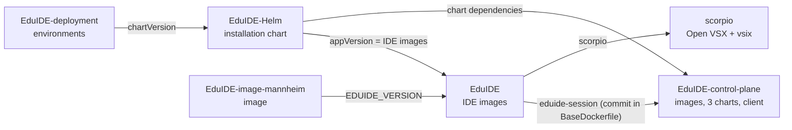

# Releases and Dependencies

Every released EduIDE repository is released by hand. No release happens on a push to `main`. A push builds and publishes `main` and preview images, nothing else. This page shows which repository pins which other repository, in which order to release, and how one release runs.

## Dependency graph

An arrow points from the consumer to the repository whose release it pins.

All repositories also use the org `.github` repository through moving refs (`@v1`, `@main`).

## The control plane release

One tag `vX.Y.Z` versions everything in EduIDE-control-plane:

| Artifact | Where |
| --- | --- |
| Images `operator`, `service`, `authz`, `agent`, `pool-scaler`, `landing-page` | `ghcr.io/eduide/eduide-control-plane/<name>:X.Y.Z` |
| Charts for the CRDs, the control plane and the landing page | OCI registry |
| OpenAPI spec | `api/openapi/v1.yaml`, semantic spec version |
| TypeScript client `@eduide/control-plane-client` | `clients/typescript` (no workflow publishes it to npm yet) |

The control plane has its own version line. The release for EduIDE 3.0.0 is 0.2.0. The installation chart pins it.

The checklist is in [`docs/development/release.md`](https://github.com/EduIDE/EduIDE-control-plane/blob/main/docs/development/release.md) and the `release` skill of the repository. In short:

1. Pick the version. A breaking REST change is a new API version, not just a new tag.
2. `make generate`, `make verify-generate`, `make lint`, `make test` and `make e2e` pass. Wait for a green `ci-ok` of the push run on the release commit on `main`, because CI does not run on the tag.
3. Update `CHANGELOG.md`. Set the chart `version` and `appVersion` and the client version to the release version.
4. Ask the maintainer, then create the tag `vX.Y.Z` on a commit of `main`. Both workflows stop unless the tag matches and its commit is on `main`. Never force-push a tag.
5. `images.yml` builds, scans and pushes the images, and `release.yml` pushes the charts. Watch them and act on failures.
6. Verify on a local kind cluster with the isolated `KUBECONFIG`.

Upgrade order for operators: the cluster chart first per cluster (additive only), then the installation chart per deployment. State it in the release notes. Never roll a productive deployment during an exam period.

## The IDE images release

EduIDE releases the images with `release.yml`, run by hand with the version (`gh workflow run release.yml -f version=3.0.0`). It creates a draft GitHub Release from the `CHANGELOG.md` section, builds all images with the version as tag, checks that every image exists for amd64 and arm64 and then publishes the release.

The base image builds `eduide-session` from the control plane repository at the commit in `EDUIDE_SESSION_COMMIT` of `images/base-ide/BaseDockerfile`. Move that commit to the control plane release commit before you release the images.

## The installation chart

The installation chart in EduIDE-Helm installs one deployment per namespace. It depends on the control plane charts and the landing page chart, and its `appVersion` pins the IDE images. Chart version and IDE image version are the same number, for example 3.0.0. A bare install without overrides pins every image, so nothing floats. See the chart reference in [Installing](/admins/install/installing) for how admins install it.

EduIDE-deployment pins the chart version of each environment in `environments/*/env.yaml`.

## Release order

A repository releases after everything it pins.

1. Leaves: scorpio and EduIDE-control-plane.
2. EduIDE, because it pins Scorpio and the control plane commit.
3. EduIDE-Helm and EduIDE-image-mannheim, because they pin the control plane charts and the IDE images.
4. Deployment pull requests that move `chartVersion` in EduIDE-deployment.

Skip every step that has no unreleased changes. A release of a leaf usually needs a new release of EduIDE, EduIDE-Helm and then a deployment pull request, because each pins the one before it.

## What each repository publishes

| Repository | Publishes | Tag format |
| --- | --- | --- |
| EduIDE-control-plane | Images, charts, spec and client | `vX.Y.Z` |
| scorpio | Open VSX extension, vsix release asset | `vX.Y.Z` |
| EduIDE | IDE images (`base`, both edition bases, the language images) | `vX.Y.Z` |
| EduIDE-image-mannheim | Image | `vX.Y.Z` |
| EduIDE-Helm | The installation chart `eduide` and the cluster chart `eduide-cluster` (OCI) | `vX.Y.Z` (chart version) |
| EduIDE-shared-cache | Helm chart (OCI), `gradle-cache` image (released on its own) | `vX.Y.Z` |
| eduide-keycloak-theme | JAR and checksum release assets | `vX.Y.Z` |
| EduIDE-deployment | Not released | none |

Use strict semver: a breaking change is a major release. Tags are `vX.Y.Z`, with `-rc.N` for release candidates. Release candidates never go to Open VSX.

## How a release runs in the other repositories

Each released repository has a release skill at `.claude/skills/release/SKILL.md`. Run it from Claude Code in that repository. The skill finds the changes since the last release, proposes a version, checks that every pin on another EduIDE repository points at its latest release, writes the changelog and opens a release pull request. After the merge, `release.yml` is dispatched with the version.

The shared `release.yml` creates a **draft** GitHub Release first, the repository's own jobs publish the artifacts, a `verify` job checks that every artifact exists, and only then the draft is published and the tag appears. A failed run leaves a draft and no tag. Fix the cause and use "Re-run failed jobs".

A tag or Release created with `GITHUB_TOKEN` does not trigger other workflows. This is why the publish jobs run from `release.yml` and not from `on: release`.

## CI checks every repository shares

- **Action pinning.** The control plane pins actions by commit SHA. The shared Renovate preset pins digests going forward.
- **Release inputs through `env:`.** Release workflows pass `inputs.version` to scripts through an environment variable, not by string interpolation into the shell.
